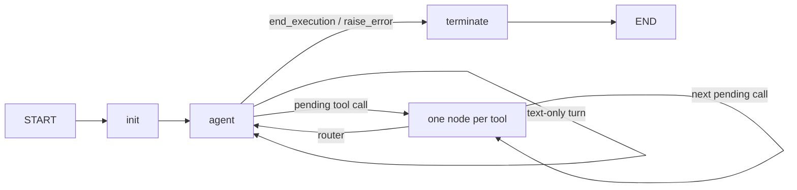

# Loops

A loop is the LangGraph graph that executes an agent: how prompts become messages, when the
model is called, how tools run and how the run ends. The agent definition (`agent.yaml`) is
loop-independent; the same agent can run under any compatible loop.

Code: `src/agents_gym_core/loops/`. The factory is `loop_factory.py` (`get_loop`,
`get_uncompiled_loop`); `loops/__init__.py` imports the loop modules the factory can discover.
Prompt rendering per loop is covered in [prompts.md](prompts.md).

## Selecting a loop

```bash
uv run gym eval --agents calculator --loops basic:any planning \
    --models gpt-4.1-mini-2025-04-14 --experiment_name loops-demo
```

| Form | Example | Resolution |
|---|---|---|
| `name:version` | `basic:any`, `planning:system-plan` | Registered loop; `name` must be a `LoopName` value |
| `name` | `basic` | Version defaults to `auto` |
| Dotted path | `my_package.loops.MyLoop` | Imported directly, no registration needed |
| Agent-level `loop:` | `loop: dspy-program:gepa_artifact.benchmarks.hover.hover_program.HoverMultiHop` (hover) | Top-level key in `agent.yaml` |

`--loops` takes several specs and runs each agent under each. The default is `basic` (`basic:auto`).

### Versions

A version names what the loop does differently:

| Version | Behaviour |
|---|---|
| `auto` (default) | `tool_choice="auto"`: the model may answer in text between tool calls (forced to call a tool after `thinking_messages_limit` text-only turns) |
| `any` | `tool_choice="any"`: a tool call on every turn |
| `auto-graceful`, `any-graceful` (`basic` only) | At the call limit, or after repeated identical tool calls, force `end_execution` instead of failing the run |

Configuration rules:

- **An agent's `loop:` replaces only the default `basic` entry** (`basic` or `basic:auto`;
  `runtime/experiment_generator.py`). `--agents hover` runs HoVer's DSPy program; `--agents
  hover --loops basic:any` explicitly selects the ReAct loop.
- **A dotted path's version is a label only.** Behaviour comes from the class's own
  `_loop_version`; a mismatch is logged as a warning, and the version you passed is recorded in
  `LoopDetails`.

## Catalogue

| Spec | Class or factory | Adds | Extra model roles |
|---|---|---|---|
| `basic`, `basic:any` | `BasicLoop`, `BasicLoopAny` | ReAct: `init → agent ⇄ tools → terminate` | none |
| `basic:auto-graceful`, `basic:any-graceful` | `BasicLoopAutoGraceful`, `BasicLoopAnyGraceful` | `graceful_termination` + `detect_tool_repetition` always on | none |
| `planning`, `planning:system-plan`, `planning:user-plan` | `PlanningLoop`, `PlanningSystemPlanLoop`, `PlanningUserPlanLoop` | `planning` node between `init` and `agent` | `planning_llm` |
| `validation` | `ValidationLoop` | `validation` node intercepts `end_execution` / `raise_error` | `validation_llm` |
| `summarizing`, `summarizing:any` | `SummarizingLoop`, `SummarizingLoopAny` | `summarizing` node before every agent call; graceful termination always on | `summarizing_llm` |
| `deep-agents` | `create_deep_agents_graph` | `deepagents` harness (todos, filesystem, sub-agents) | none |
| `dspy-program:<dotted.path>` | `create_dspy_program_graph` | Runs a `dspy.Module`; the version is its import path | any constructor parameter name |

## Model roles

Each role is a key in the `--models` JSON. Missing roles fall back to `model`.

```bash
--models '{"model": "gpt-4.1-mini-2025-04-14", "planning_llm": "gpt-5-2025-08-07"}'
```

| Key | Used by |
|---|---|
| `model` | Every loop (required) |
| `planning_llm`, `validation_llm`, `summarizing_llm` | The matching loops above |
| `embeddings` | Vector-database tools, the `BasicLoop` memory store |
| any other key | Passed by name to the loop constructor (or, for `dspy-program`, the program constructor); ignored if it takes no such parameter |

The testbed's default `--models` includes `embeddings: text-embedding-3-large`, and a plain model
name (`--models gpt-4.1-mini-2025-04-14`) gets the same default embeddings, which
vector-database tools need.

A role appears in the loop key only when it is supplied and the loop uses it, except in
`dspy-program`, whose loop key has every supplied chat-model role, used or not, and never
`embeddings`. The loop key names the output directory:
`experiments/<experiment_name>/<agent>/<version>/<loop_name>/<loop_key>/`, with
`loop_key = "<name>__<version>__model:<m>,<other roles sorted>,embeddings:<e>"`, e.g.
`planning__auto__model:gpt-4.1-mini-2025-04-14,planning_llm:gpt-5-2025-08-07,embeddings:text-embedding-3-large`.

## The ReAct core (`BasicLoop`)

Every loop except `deep-agents` and `dspy-program` subclasses `BasicLoop`.



- `init` renders the system and user messages ([prompts.md](prompts.md)).
- `agent` is `create_custom_llm_node` (`nodes.py`). Its tools are the agent's tools plus
  `end_execution` and `raise_error`, which are added unless the agent is conversational.
- `terminate` validates the `end_execution` arguments against `output_schema` or raises the
  `raise_error` message.
- All nodes are wrapped in UiPath guardrail subgraphs (no guardrails unless passed).

### Routing

`create_route_agent` (uipath_langchain) runs after `agent` and after every tool node:

| Latest AI message | Next node |
|---|---|
| Pending tool call is `end_execution` or `raise_error` | `terminate` |
| Pending tool call is a regular tool | That tool's node. Calls run one at a time, in order, even when the model emitted several |
| All its tool calls have run | `agent` |
| No tool calls, has content | `agent` |
| No tool calls, no content | `ROUTING_ERROR` |

Before routing, the LLM node drops `end_execution` / `raise_error` from a message that also
calls a regular tool, so the run continues. If a message calls only control-flow tools,
`raise_error` wins.

Conversational agents use `create_route_agent_conversational`: an AI message without tool calls
goes to `terminate`, so the run ends at the first plain answer.

### LLM node safeguards

Checked in this order on every call (`create_custom_llm_node`):

| Safeguard | Trigger | Effect |
|---|---|---|
| Iteration limit | `inner_state.tools_storage["total_llm_calls"] >= llm_messages_limit` | Raises `TERMINATION_MAX_ITERATIONS`; with `graceful_termination`, forces `end_execution` instead |
| Repetition (`detect_tool_repetition`) | Any identical call (tool name + JSON args, sorted keys) seen `max(llm_messages_limit // 3, 2)` times | Forces `end_execution`. Control-flow tools are not counted |
| Thinking limit | Trailing text-only AI turns `>= thinking_messages_limit` | Rebinds with `tool_choice="any"`; registered HuggingFace and vLLM models receive "You must call a tool now." instead. If the count already exceeds the limit, raises `THINKING_LIMIT_EXCEEDED` |
| Empty response | Empty content and no tool calls, with tools bound | One retry with the same tool-call requirement: `tool_choice="any"`, or the directive above for registered HuggingFace and vLLM models |

"Forces `end_execution`" means `force_end_invoke` (`utils.py`): bind only `end_execution`, append
"You have used all available iterations. You MUST call end_execution now…", call with
`tool_choice="any"`. The counter lives in `inner_state`, so it survives summarization.

Conversational mode disables the first three safeguards; the empty-response retry applies when
tools are bound. In non-conversational runs with bound tools, registered Anthropic models receive
a "Please continue." user turn after a text-only AI message. Turn alternation and tool forcing
are handled separately.

### Configuration and defaults

| Setting | Under the testbed | Set by |
|---|---|---|
| `llm_messages_limit` | 20 | `UIPATH_AGENTS_GYM_LOOP_RECURSION_LIMIT` |
| `thinking_messages_limit` | 5 | `UIPATH_AGENTS_GYM_NO_TOOL_MESSAGES_LIMIT` |
| `parallel_tool_calls` | `False` | `--parallel_tool_calls` (the testbed always passes it, overriding `UIPATH_AGENTS_GYM_PARALLEL_TOOL_CALLS`) |
| `handle_tool_errors` | `False` | `--handle_tool_errors` |
| `tool_choice` | `"auto"` (`"any"` for `any` versions) | Loop version or constructor kwarg |
| `graceful_termination`, `detect_tool_repetition` | `False` except where noted | Loop version or constructor kwarg |
| `with_memory`, `memory_tools` | `False` | Constructor kwarg: an `InMemoryStore` (needs `embeddings`) and the `manage_memory` / `search_memory` tools. The store belongs to the loop instance and the tools use the fixed namespace `("memories",)`, so memories persist across the datapoints and runs that share that loop instance |
| `strict` | `None` | Constructor kwarg |

The limits come from `get_default_graph_config`, which builds an `AgentGraphConfig`. A loop built
directly with no `config` gets `AgentGraphConfig()` defaults instead: 25 calls, thinking limit 0,
parallel tool calls on.

Configuration behavior:

- **`thinking_messages_limit=0` forces a tool call on every turn**: 0 text-only turns already
  meets the limit, so `auto` behaves like `any`.
- Set `tool_choice` and `strict` as constructor kwargs.
- `handle_tool_errors=True` returns a tool exception as a `{"error": "Error: <repr>"}` result
  the model can read; `False` propagates it as a run error.
- The factory passes shared model roles and `UIPATH_AGENTS_GYM_SUMMARIZATION_SETTINGS` to
  loop constructors. Each loop applies its own options and ignores other kwargs.
- `build_compiled_graph()` caches the compiled graph unless a `checkpointer` is passed.

## Variants

### Planning (`planning:*`)

`START → init → planning → agent ⇄ tools → terminate → END`

`planning_llm` (no tools bound) writes a plan from `PlanningPrompt.PLANNING_SYSTEM_PROMPT_PLATFORM`
and `PLANNING_USER_PROMPT_PLATFORM`, given the system prompt, user prompt and tool list.

| Version | Plan goes into |
|---|---|
| `auto` | A new user message (`PlanPromptTemplate.PLAN_PROMPT_TEMPLATE_INCLUDE_END_EXECUTION`) |
| `system-plan` | The system message, rewritten in place with the same message id |
| `user-plan` | The first user message, rewritten in place with the same message id |

Constructor: `planning_llm`, `planner_system_prompt`, `planner_user_prompt`,
`plan_insertion_prompt`.

### Validation (`validation`)

```
START → init → agent ⇄ tools
                              │ end_execution / raise_error
                              ▼
                          validation ── passed ──→ terminate → END
                              │ failed
                              └──→ agent
```

`validation_llm` sees the system prompt, user prompt, tools and the full trajectory. It passes
when the last line of its reply is `VALIDATION PASSED` (any case), optionally after `Verdict:`,
wrapped in `**`, `__`, `*`, `_`, a backtick or quotes, and followed by `.` or `!`. On failure,
the terminating AI message is removed and `"Validation failed. <reply>\nPlease try again."` is
appended as a user message.

- **Only the last line decides**: a verdict earlier in the reply, or a reply that ends in prose,
  fails. The built-in validator prompt asks for the verdict on its own final line.
- `raise_error` is validated too.
- Retries are bounded only by `llm_messages_limit`.
- Validation uses structured `end_execution` / `raise_error` termination. Use the basic loop
  for conversational agents.

Constructor: `validation_llm`, `validator_system_prompt`, `validator_user_prompt`.

### Summarizing (`summarizing:*`)

`START → init → summarizing → agent ⇄ tools`. Every route back to `agent` (from tools and from
the agent's text-only self-loop) passes through `summarizing`; `terminate` does not.

The node is langmem's `SummarizationNode` (`DeduplicatingSummarizationNode`, which also drops a
duplicated summary message). It fires only when both hold, with tokens estimated as
`chars/4 + 3` per message:

1. non-system tokens `>= max_tokens_before_summary`
2. system tokens `<= max_tokens - max_summary_tokens`

| Parameter | Default | `long_summary` tag |
|---|---|---|
| `max_summary_tokens` | 800 | 2500 |
| `max_tokens_before_summary` | 800 | 2500 |
| `max_tokens` | 4000 | 8000 |

Also: `summarizing_llm`, `initial_summary_prompt` / `existing_summary_prompt` (`core::` files in
`node_prompts/`, inline text, or `None` for langmem's defaults), and `inject_agent_instructions`
(default `True`), which prepends the agent's system prompt to the summary prompts.
`UIPATH_AGENTS_GYM_SUMMARIZATION_SETTINGS` (a dict) supplies these kwargs; the `long_summary`
tag overrides its token budgets.

- Summarization requires the system prompt to fit within `max_tokens - max_summary_tokens`
  (about 3200 estimated tokens at the defaults).
- `graceful_termination` is always on. `detect_tool_repetition` is off unless passed.

### DSPy programs (`dspy-program`)

`dspy-program:<path>` runs the `dspy.Module` at `<path>` (`dspy_program_loop.py`). It needs the
`dspy` extra (`uv sync --locked --extra dspy`). The model is wrapped as `GymLM` and set with
`dspy.context(lm=...)` per call. The loop does not use the agent's `tools` or render
`user_prompt`, and returns only `output_schema` fields. Each predictor's instructions are
`signature_prompts[predictor]`, else `system_prompt`, else the program's own
([prompts.md](prompts.md#dspy-programs)).

- `<path>` is a `dspy.Module` subclass, which is instantiated, or a module-level instance, which
  is deep-copied. aime_2025_agent uses the instance `...AIME_program.program_cot`; hover and
  papillon use classes.
- **Constructor parameters are filled by name from the model roles.** A required parameter with
  no matching role uses the primary model by default. PAPILLON takes `untrusted_model`:
  pass `--models '{"model": "...", "untrusted_model": "..."}'` or both roles use one model.
- `signature_demos` become each predictor's `demos`.
- The programs come from the `gepa-artifact` submodule; `import agents_gym_core` puts it on
  `sys.path`, and `GEPA_ARTIFACT_DIR` points at another checkout. Without the submodule (a wheel
  install), `gym init` clones it at the pinned commit into `~/.cache/agents-gym-core`.
- `GymLM` calls the wrapped LangChain model directly, bypassing DSPy's cache reads and writes.
  It intentionally ignores DSPy's per-call model options so the wrapped model's evaluation
  settings remain authoritative.

The published `dspy` extra carries the same LiteLLM security range as Core's dependency
policy in [pyproject.toml](../../pyproject.toml).

### Deep agents (`deep-agents`)

Uses `deepagents.create_deep_agent`, which provides filesystem tools (`ls`, `read_file`,
`write_file`, `edit_file`, `delete`, `glob`, `grep`) and the `task` sub-agent tool; Core adds
`write_todos` (below). `delete` is intentionally retained: with the default `StateBackend`, it removes
files from graph state, not the host filesystem. A configured backend determines the actual
storage boundary.

- `end_execution` and `raise_error` are added with `return_direct=True`. The system prompt gets
  "You MUST call end_execution for output — never plain text…" appended.
- The testbed converts inputs with `build_deep_agents_input` (`user_prompt.format_map`, or
  `json.dumps(inputs)` on a missing key). It reads output from the `end_execution` tool message
  (`normalize_deep_agents_output`), falling back to the last AI message.
- Parallel tool calls follow `config.parallel_tool_calls`, which comes from
  `UIPATH_AGENTS_GYM_PARALLEL_TOOL_CALLS`. The testbed's `--parallel_tool_calls` kwarg is
  stripped.
- Kwargs `create_deep_agent` does not accept are removed via `_GYM_ONLY_KWARGS`. A new loop
  kwarg must be added there.
- `SummarizationMiddleware` is added only when summarization kwargs and a `backend` kwarg are
  both given.
- Core supplies planning middleware for DeepAgents 0.7 (`deepagents==0.7.26`).
  Coordinators, the default general-purpose sub-agent, researchers and caller-supplied
  declarative sub-agents receive `write_todos` in both delegation modes unless the resolved
  model profile owns planning. Existing profile or caller planning middleware is not
  replaced or duplicated. Provider and model-specific profiles retain their normal SDK
  precedence; profile-disabled general-purpose agents stay disabled, while explicit
  caller-supplied agents remain available. Precompiled and remote agents keep their own stacks.
- GP-specific profile prompts use native SDK assembly, including their precedence over the
  general profile's base prompt. Such profiles must supply `TodoListMiddleware` through
  `extra_middleware` to enable planning on that general-purpose agent. Callable
  `extra_middleware` also opts its resolved model's coordinator and declarative sub-agents
  out of Core's planning defaults: only the SDK executes the factory, and the factory owns
  whether and how planning is supplied. Core does not rewrite system-message blocks or
  register or mutate global profiles.

## Writing a loop

Subclass `BasicLoop`, set `_loop_name` and `_loop_version` (and `default_tool_choice` for an
`any` variant), and override the narrowest hook:

| Hook | Use it to |
|---|---|
| `_create_messages(state)` | Change the initial messages |
| `add_worker_graph(builder)` | Rewire the graph; call `_create_all_nodes(builder)` to get the standard nodes |
| `_add_tool_edges(...)` | Insert a step between tools and the router |
| `_create_graph_state()` | Add state fields (as `SummarizingLoop` adds `context`) |

Reach it by dotted path; no registration needed. A plain function returning an uncompiled
`StateGraph` also works as a dotted-path target. It receives whichever of `scenario`, `model`,
`models`, `config`, `settings` and extra kwargs its signature declares (all of them with
`**kwargs`).

To make a loop reachable by name, add a `LoopName` value **and** import the module in
`loops/__init__.py`. The factory discovers classes through `BasicLoop.__subclasses__()`, which
only sees imported classes; a module that is not imported, or fails to import, leaves its loops
undiscoverable.
